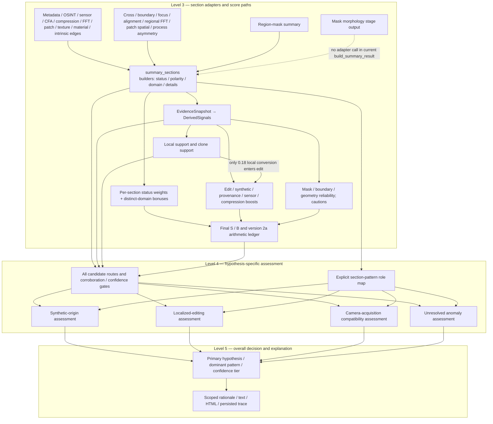

# Evidence dependency graph

Solid arrows show confirmed runtime data flow or mathematical transformation.
Dotted arrows identify shared feature code, suspected measurement overlap, or
non-scoring presentation as labeled. No arrow asserts statistical independence.
These panels expand the same architecture rather than separate pipelines.

## Levels 1–3: source observations, extracted features, derived evidence

```mermaid
flowchart TB
  subgraph L1[Level 1 — source observations and spatial support]
    P[Original pixels]
    META[Embedded metadata fields]
    WEB[Analyst reverse-search review]
    PREP[Prepared global / patch / subject images]
    PERSON[MediaPipe foreground confidence and person mask]
    LEGACY[Optional legacy edge / saliency mask]
    MASK[Selected subject / boundary / background masks]
    P --> PREP
    P --> PERSON
    P --> LEGACY
    PERSON -->|central reliability contract| MASK
    LEGACY -->|explicit fallback only| MASK
  end
  subgraph L2[Level 2 — extracted measurements]
    ELA[ELA recompression difference / block hotspots]
    NOISE[Gaussian residual / block hotspots]
    SENSOR[Luminance residual / 2x2 phase structure]
    CFA[Chroma residual / 2x2 phases / directionality]
    COMP[Aligned / off-grid JPEG-boundary proxy]
    FFT[Global FFT peaks / radial profile / grid response]
    RFFT[Soft regional crops → same FFT analyzer ×3]
    PATCH[Patch descriptors → retained neighbor pairs / recurrence]
    TEXTURE[Subject / background hybrid descriptors and recurrence]
    FEATURE[Regional patch variance / residual / entropy / gradients / DCT]
    EDGE[Intrinsic gradient bands / rings and transition metrics]
    METAS[Metadata watchlist / workflow declarations]
    OSINT[Reviewed source category / match state]
    P --> ELA
    P --> NOISE
    P --> SENSOR
    P --> CFA
    P --> COMP
    P --> EDGE
    PREP --> FFT
    PREP --> RFFT
    PREP --> PATCH
    PREP --> TEXTURE
    PREP --> FEATURE
    MASK --> RFFT
    MASK --> TEXTURE
    MASK --> FEATURE
    META --> METAS
    WEB --> OSINT
  end
  subgraph L3[Level 3 — derived interpretations and composite indicators]
    CROSS[Hotspot spatial overlap / shared clusters / hotspot_mask]
    BOUNDARY[Contour / fragment boundary interpretation]
    FOCUS[ELA / residual intensity by mask region]
    ALIGN[Shared hotspot_mask overlap with boundary band]
    SPATIAL[Same patch pairs classified by mask-region topology]
    ASYM[Subject-process asymmetry plus carry-forward / fallbacks]
    MATERIAL[Material regularization / homogenization score]
    SEG[Mask fragmentation / boundary-density interpretation]
    ELA --> CROSS
    NOISE --> CROSS
    CROSS -->|same overlap and parent patterns| BOUNDARY
    ELA -->|saved scaled map, not new recompression| FOCUS
    NOISE -->|saved scaled map, not new residual| FOCUS
    MASK --> FOCUS
    CROSS -->|filtered hotspot_mask array| ALIGN
    MASK --> ALIGN
    PATCH -->|top_pairs and scale_info| SPATIAL
    MASK --> SPATIAL
    FEATURE --> ASYM
    TEXTURE -->|background reliability and carry-forward| ASYM
    RFFT -->|carry-forward| ASYM
    FEATURE -->|separate sampling using same helpers| MATERIAL
    MASK --> SEG
  end
  SENSOR -.->|similar residual family, not shared payload| CFA
  NOISE -.->|similar residual measurements| SENSOR
  FFT -.->|same FFT code, different pixels / crop| RFFT
  PATCH -.->|related recurrence, new descriptors| TEXTURE
  ASYM -.->|shared extraction / aggregation helpers, not result payload| MATERIAL
  EDGE -.->|overlapping residual / gradient families| FEATURE
```

## Levels 3–5: scoring, hypothesis assessment and overall selection

The dotted SEG edge denotes an **absent current integration**, not a hidden score
path. `summary_synthesizer.build_summary_result()` builds 20 section keys and
omits `build_region_segmentation_section()`. Furthermore,
`hypothesis_engine.build_evidence_snapshot()` deliberately aliases
`region_segmentation` to `sections['region_masks']`. Mask ratios/reliability reach
scoring; the executed morphology stage's fragmented/clean interpretations do
not. The scorecard contains corresponding branches that are dormant in this
normal integration. Wiring them in would add behavior and requires a separate
review; the audit does not activate them.

## Shared arrays, coordinate systems and edge semantics

| Intermediate | Actual producers / consumers | Dependency interpretation |
| --- | --- | --- |
| ELA difference and block statistics | `vf_ela.compute_diff_array`, `compute_blockwise_ela_stats` → controller `_cross_signal` | Cross consumes block lists, not raw pixels |
| Residual array and hotspots | `vf_noise.compute_residual_array`, `compute_blockwise_residual_stats` → same controller method | Separate transform of same image; overlap is computed from existing lists |
| `overlap`, shared cluster blocks, `hotspot_mask` | `vf_cross_signal.compute_cross_signal_payload` → boundary classifier, alignment and overlays | Multiple interpretations of parent observations; overlay is presentation only |
| Saved ELA/residual maps | `vf_boundary_focus._extract_ela_map`, `_extract_noise_map` | Reloads normalized visual intensity maps; optional overlay fallback is less clean as a measurement source |
| `top_pairs`, `scale_info` | `vf_patch_similarity.run_patch_similarity_analysis` → `vf_patch_spatial.run_patch_spatial_analysis` | No fresh matching; adds endpoint localization and mask-based density |
| Selected masks | `vf_person_subject_mask.derive_region_masks_from_person_mask` / optional `vf_region_masks.run_region_mask_analysis` → eight regional consumers | Common geometry can create shared failure modes; mask quality is not independent image evidence |
| Regional FFT crops | `vf_region_fft._extract_soft_region_crop` → three calls to `vf_fft.run_fft_analysis` | Fresh transforms on overlapping cropped content, with mean-fill/soft-mask preprocessing |
| Regional patch features | `vf_subject_process_asymmetry._extract_patch_features`, `_aggregate_region_metrics` also imported by material realism | Same feature definitions; separate calls/samples, not shared cached metric arrays |
| Texture / regional FFT payloads | asymmetry `_compute_baseline_reliability`, `_compute_scores` | Confirmed result reuse: texture-derived penalties and 0.08/0.06 sigmoid carry-forward |
| Intrinsic image-edge rings | `vf_subject_boundary.make_boundary_mask`, `ring_masks`, `region_masks` | Different from selected person boundary; summary reliability gate limits the claim but does not make these geometries identical |

Actual runtime lineage is acyclic. An AST traversal of the 20 `vf_*.py` modules
also finds no detector import cycle. The feature-helper import from material
realism into asymmetry's implementation module is one-way; asymmetry does not
consume material realism's output. Hypothesis selection feeds no detector.

Source anchors: `signallens_controller.SignalLensController.run_analysis`,
`._cross_signal`, `._select_region_masks`; `summary_synthesizer.build_summary_result`;
`hypothesis_engine.build_evidence_snapshot`, `.derive_signals`, `.compute_scorecard`;
`decision_logic.evaluate_hypotheses`; `hypothesis_evidence.scope_hypothesis_evidence`.
Exact function/operation line anchors are also in the two CSV inventories.
