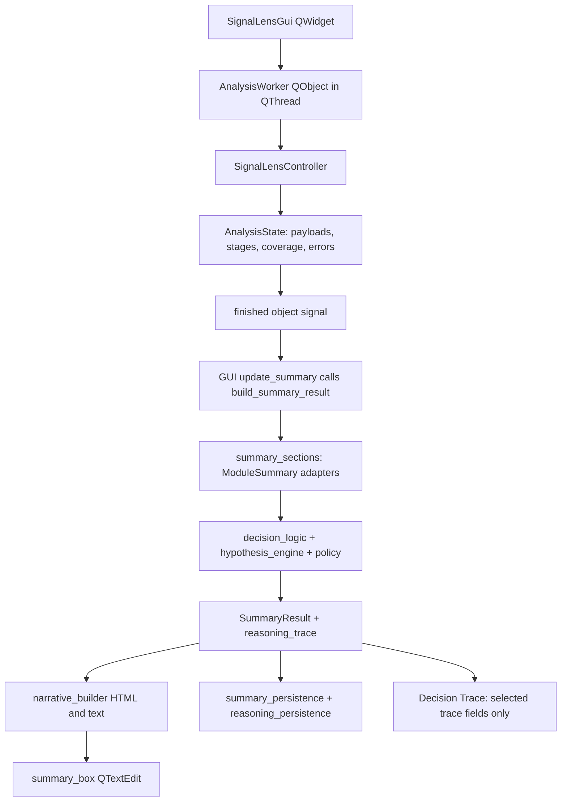

# UI-0: current architecture inventory

Audit date: 3 November 2026. Repository: `D:\Coding\SignalLens`; branch `main`, HEAD `00c5eb2` (not the supplied `24705fe`). `564c0ee` remains in recent history. At entry the reasoning-engine DOCX was modified; the task Markdown and Word lock file were untracked. These are pre-existing, preserved changes. No AGENTS.md was found in the workspace search. This audit does not implement a redesign.

## Scope and evidence

Read the active GUI, worker, controller, settings, OSINT, summary, reporting and reasoning paths, and detector output writers. `source_index.json` records actual classes, methods, imports and line numbers for all 56 root Python modules. `legacy/` contains no files in this checkout. No standalone QSS/QRC, Designer UI, dock system, embedded chart library or image-viewer widget was found in the active UI. `signallens.png` is the window icon; `SignalLens.spec`, `app_paths.py` and the bundled segmentation model support packaging/resources, not a design system.

Evidence labels throughout this package: **S** source-confirmed; **V** viewed in the running application; **R** real widget rendering of an existing stored summary through the isolated replay harness; **I** inferred usability risk, not a user study. Screenshots are actual captures, not wireframes. Result replay is not a new detector run.

## Current data path

The controller is independent of Qt and uses log/status callbacks. Worker status and log signals return to GUI slots; no numerical progress or cancellation protocol exists. The worker does not synthesize the final summary: the GUI calls the authoritative reasoning orchestration on the GUI thread after completion and after OSINT mutations. This is orchestration coupling, not evidence that the GUI independently implements forensic thresholds. Preserve the existing authoritative functions.

## Component inventory

All file references below are relative to repository root. Row groups retain real widget attributes; unnamed dialogs are methods, not invented classes. State: L = local widget state; S = shared AnalysisState/SummaryResult; P = filesystem persistence.

|Component / source|Parent and responsibility|Data source / dependencies|State handling|Visual and architectural issues|Action|
|---|---|---|---|---|---|
|`main`, `SignalLensGui.__init__`; `signallens_gui.py`|QApplication / top-level QWidget; startup, drops, ownership|load_settings, QIcon, QTimer|L paths and duplicate payload attributes; cached settings P|700×360 requested but layout minimum expands it; bottom positioning; no geometry restore; too many responsibilities|Redesign shell, retain bootstrap/resources|
|`_create_menu_bar`, `menu_bar`; same|Main window; File / Tools / Help|QAction callbacks to same class|L action enablement|File contains Exit only; trace and evidence folders under Tools, mixed with destructive archive actions; no explicit shortcuts|Refine grouping; keep commands|
|`drop_label`, `file_edit`, `pick_button`, drag/drop handlers; same|Main; choose supported file|settings extensions and masks; pathlib|L selected/current paths; mkdir on selection; OSINT load/init P|Filename only, no preview; selection writes before analysis; run folders use stem|Retain input workflow; redesign source panel|
|`analysis_mode_combo`, `on_analysis_mode_changed`; same|Main; normal / subject_based patch profile|worker → controller; signallens_settings profiles|L profile survives Clear|Raw identifier wording; no explanation inline|Refine labels, preserve values|
|`context_group`, four `chk_*`; same|Main; analyst-supplied context|update_summary → build_summary_result scene_context|L; read at summary time|Not passed to worker; context can change during run; checkbox toggles alone do not refresh summary|Refine configuration and run snapshot ownership|
|`summary_box`, `update_summary`; same|Main; forensic narrative|SummaryResult.full_html; summary_synthesizer|S; regeneration replaces HTML|160–220px height, all modules in one scroll; no structured selection; key hypothesis visible only in prose|Replace presentation, retain reasoning result|
|`run_button`, `run_analysis`; same|Main; start QThread and worker|AnalysisWorker; output paths and profile|L thread/worker refs|Only Run disabled; choose, Clear, context and OSINT remain actionable during run|Redesign lifecycle ownership|
|`log_box`, `log`, `status_label`; same|Main; processing feedback|worker.log/status; gui_semantics colors|L; append and auto-scroll|100px fixed log; no stage list, count or cancellation; colored text on default palette|Refine and make details collapsible|
|`open_json_button`, `open_output_folder`; same|Main; reveal EXIF JSON in file manager|output_root + selected stem; output_json existence|L enabled when EXIF payload exists|Label says Results Folder, behavior selects one JSON; result access coupled to EXIF success|Refine artifact access|
|`clear_button`, `clear_ui`, `clear_analysis_state`; same|Main; reset visible session|local payloads, paths, checkboxes|L; does not delete artifacts|No running-thread guard; profile retained; payload list duplicates state schema|Refine session reset with run ID|
|`osint_group`, `build_osint_group`, `refresh_osint_ui`; same|Main; 7 action buttons, status, QListWidget|osint_reverse_search; ReverseSearchResult/Match|L plus osint_results.json P|Large permanent area; initial edit/delete buttons not explicitly disabled until refresh; manual records can trigger new synthesis|Relocate to Provenance / OSINT|
|`OSINTFindingDialog`; `osint_dialogs.py`|Main modal; add/edit match|provider, URLs, title, score, date, source type, notes|L edit buffer → parent saves P|Form is reusable; URL required; 0 similarity maps to missing; no date validation|Retain/refine; keep analyst attribution|
|`show_decision_trace_dialog`; `signallens_gui.py`|Main modal QDialog / QTextBrowser, 1050×750|summary_result.reasoning_trace|S read-only projection|Final decision, priors, 11 score fields, selected derived signals, six-column routes; omits structured hypotheses/policy/coverage/lineage; unescaped interpolated values|Replace with structured Reasoning view; retain raw access|
|`show_settings_dialog`, `SettingsDialog`; `settings_dialog.py`|Main modal; settings editor|load/save/reset_settings; JSON|L deep copy + P JSON; load cache invalidated on save|820×720; four tabs; no scroll wrappers on growing profile forms; parent retains old self.settings dict after save|Retain forms; refine lifecycle and sizing|
|`_build_general_tab`; settings_dialog.py|Settings tab; output folder, extensions, masks|settings dictionary; browse QFileDialog|L until Save|Useful labels; two independent format fields can diverge|Refine validation/refresh|
|`_build_patch_profiles_tab`; same|Settings tab; six fields per profile|QSpinBox/QDoubleSpinBox factories; normal/subject_based settings|L → P save|Expert numerical settings appear as ungrouped workload; tall form|Retain, add explanations/scroll|
|`_build_region_profiles_tab`; same|Settings tab; subject/boundary/background budgets|subject_background_profiles|L → P save|Advanced controls need profile context|Retain/refine|
|`_build_json_preview_tab`, `_save_and_accept`, `_reset_to_defaults`; same|Settings; raw preview/save/reset/open file|settings validation and OS file handler|P, reset writes immediately after confirmation|Preview read-only/no wrap; external settings editor; reset differs from unsaved form edits|Retain advanced access; clarify save semantics|
|`show_audit_trail_overview`; `signallens_gui.py` + `AuditManager` in audit_manager.py|Main modal; archive totals and up to 100 runs|filesystem scan of hardcoded analyzed|P read; no case model|HTML table, 900×650, no sorting/filter; configured output_root ignored|Refine with model-backed archive view|
|cleanup/delete-old/remove-visuals methods; same|Tools confirmations; delete archive artifacts|AuditManager hardcoded analyzed|P destructive actions|Dangerous operations adjacent to investigation tools; confirmation exists|Retain functionality in archive management|
|About / Known Limitations / Send Feedback; same|Help QMessageBoxes / external browser|version constants, static limitations, feedback URL|L; feedback URL includes version/OS/audit-folder text|Limitations available but remote from result; browser action external|Retain; surface relevant limits in overview|
|`AnalysisWorker`; analysis_worker.py|QObject moved to QThread; async controller bridge|SignalLensController|S finished object, string errors/log/status|Success connects quit/deleteLater; error has no matching cleanup connections; no cancel|Retain bridge; harden lifecycle|
|`AnalysisState`, `SignalLensController`; signallens_controller.py|Non-Qt pipeline and result owner|all vf modules, image_gatekeeper, exiftool_backend, mask_contract, RunRecorder|S payloads/errors/stage_statuses/coverage; P artifacts|Good backend seam; partial failures explicitly retained; artifact schemas heterogeneous|Retain; add presentation adapter only|
|`ModuleSummary`, colors; gui_semantics.py|Shared summary dataclass / display semantics|status/polarity/artifacts/details|S; colors constants|Backend imports GUI-named module; colors hardcoded for mixed surfaces; status not run is not failure reason|Retain semantics; separate future theme tokens carefully|
|`SummaryResult`; summary_types.py; `build_summary_result`; summary_synthesizer.py|Authoritative summary orchestration|section builders → decision_logic → narrative_builder|S structured + rendered duplicates|GUI owns invocation; valid structured data mostly flattened to prose|Retain canonical result; consume structured fields|
|`summary_sections.py`, `signal_language.py`, `narrative_builder.py`|Module adapters, human labels, text/HTML|detector payloads; evidence interpretation|S; output serialization|20 ordered module sections; rendering emits only name/note; HTML uses browser CSS variables/media query in QTextEdit|Retain labels/adapters, refine renderer|
|summary_persistence.py / reasoning_persistence.py / run_reporting.py|Persistence, trace text, manifest/log writer|SummaryResult, trace, RunRecorder|P JSON/TXT/HTML, reasoning traces, manifest|No export wizard or PDF UI; OSINT re-synthesis saves OSINT but does not re-persist final summary|Retain serializers; unify report snapshot boundary|

## Detector and artifact inventory

Common current GUI behavior for **every** detector below: module name/note in the summary (20-section order in narrative_builder), selected scalar information in trace, and artifacts accessed externally through folders. No embedded visual, enlargement, comparison, source persistence, region-click explanation, overlay slider, legend control, zoom or pan exists. External image applications may enlarge files; that is not a SignalLens feature. Missing module output can become an explicit unavailable note via stage_statuses; no dedicated stage table appears in the GUI.

|Detector/module|Existing output verified in writer|Current summary adapter / future action|
|---|---|---|
|vf_ela.py|ELA difference PNG, recompressed JPEG, hotspot overlays on original and difference, JSON block data|build_ela_section; retain visual and recompression caveat|
|vf_noise.py|Noise residual PNG, overlays on source/residual, JSON blocks|build_noise_section (`Residual`); retain|
|vf_cross_signal.py + vf_overlay.py|Convergence/boundary payload; shared boundary overlays on source/ELA/noise|build_cross_signal_section + build_boundary_section; relate to parent observations, not independent votes|
|vf_boundary_focus.py|Boundary focus preview PNG and regional metrics|build_boundary_focus_section; use actual mask reliability|
|vf_fft.py|Spectrum, peakmap, radial profile raster, grid and multi-grid response/overlays, metrics and JSON|build_fft_section; separate frequency-space from image-space views|
|vf_region_fft.py|Soft masked/cropped regional inputs; nested FFT results and regional comparisons|build_region_fft_section; synchronize only after crop offsets and geometry confirmed|
|vf_patch_similarity.py|Patch pair coordinates, match overlay, recurrence heatmap and JSON|build_patch_similarity_section; pair selection from existing coordinates is feasible|
|vf_patch_spatial.py|Region-pair categories/metrics, reused recurrence/patch artifact paths|build_patch_spatial_section; do not invent a separate spatial heatmap|
|vf_person_subject_mask.py + vf_region_masks.py|Person mask/overlay, subject/boundary/background masks and diagnostics; legacy mask fallback disabled by default|build_region_mask_section; distinguish approximate/limited/unavailable geometry|
|vf_region_segmentation.py + vf_segmentation_alignment.py|Region segmentation payload; alignment measurements from existing masks/boundaries|alignment is summarized; build_region_segmentation_section exists but is not wired into build_summary_result; retain diagnostic detail|
|vf_subject_boundary.py|Image-edge boundary metrics and JPG overlay|build_subject_boundary_section; not proof of a validated person boundary|
|vf_subject_texture_consistency.py|Subject similarity overlay plus subject/background focus masks and metrics|build_subject_texture_consistency_section; show masking scope|
|vf_subject_process_asymmetry.py|Subject/background regional processing comparisons and JPG overlay|build_subject_process_asymmetry_section; retain qualifications|
|vf_subject_material_realism.py|Variance-derived material overlay and regional metrics|build_subject_material_realism_section; no semantic material truth map|
|vf_sensor_origin.py|Block metrics and sensor overlay JPG|build_sensor_origin_section; camera compatibility does not authenticate history|
|vf_cfa_demosaic.py|CFA metrics and block overlay JPG|build_cfa_demosaic_section; limitations stay attached|
|vf_compression_history.py|Compression-history metrics and overlay JPG|build_compression_history_section; JPEG-style save history, not authenticity|
|exiftool_backend.py + osint_reverse_search.py|Metadata records/signals, manual OSINT records/URLs|build_metadata_section / build_osint_section; raw tag browser absent|

Image-space files can be opened in a common viewer without changing detectors. Meaningful linked cursors require verified transforms from `prepared_images_payload` (global 1024, patch 1400, subject 1024 maximum dimensions; ELA original dimensions). Spectrum coordinates must never be overlaid as source-pixel locations. Opacity adjustment for a baked JPG is not equivalent to controlling its underlying detector mask: use available raw maps/masks or display the baked artifact honestly.

## State and architecture risks to carry forward

1. `set_selected_file` clears analysis_state/summary but does not disable old Decision Trace/Open Latest Audit actions or clear summary_result/all payloads. A previous trace can remain accessible until Clear or a new result. **S**, not exercised with evidence mutation.
2. Clear/reselection during a worker run can disconnect current paths/context from the returned state; on_analysis_finished has no request-ID check. **S/I**; do not reproduce by interrupting an active forensic run during this audit.
3. `update_summary` after OSINT changes updates GUI reasoning, while persisted final summary remains the earlier snapshot. **S**. Reports need explicit revision/source identity.
4. `self.settings` is loaded at startup; SettingsDialog invalidates loader cache but does not replace the parent copy. Controller profile getters reload, while file selection/output root can remain stale. **S**.
5. Worker exceptions emit error, but error path does not quit/delete the worker thread. GUI close has no closeEvent coordination. **S**. Fix before adding navigation complexity.
6. Archive commands ignore configured output_root; stem-based folders can collide across distinct source paths. These are lifecycle/persistence decisions requiring bounded implementation, not cosmetic quick wins.

No explicit `setShortcut`, QSettings window persistence, splitter, dock, QAbstractItemModel, QTableView or QGraphicsView is present in active GUI code. Standard Qt text selection/copy and native control focus remain available; bespoke forensic-result copy actions are absent.
