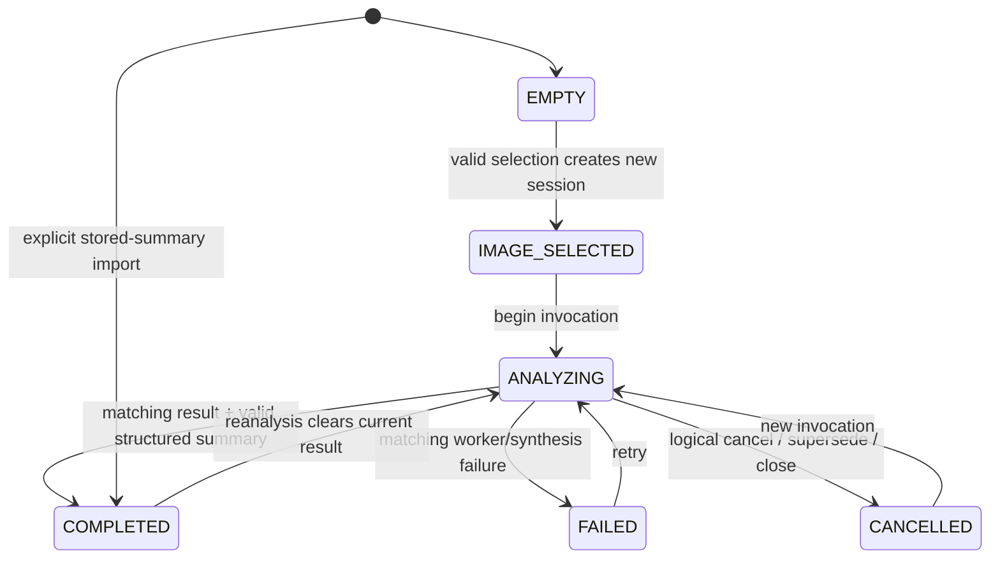

# UI-1 investigation lifecycle

Implemented 3 November 2026. This phase retains the current QWidget interface; no workspace/theme redesign is included.

## Identity and ownership

`InvestigationSession` is Qt-free. Every successful selection, including selecting the same image again, creates a fresh UUID session. Every `begin_analysis` creates an immutable `AnalysisInvocation` with its own UUID, source path/hash, profile, launch-time context, serialized settings and OSINT annotations/revision, output directory and timestamp. Result identity is the invocation ID; successful completion increments the session's analysis revision. A filename is never used as result identity.

Raw `AnalysisState` is retained by reference; arrays/payloads are not copied into presentation/session snapshots. The comparatively small authoritative SummaryResult is serialized once into private-by-convention `summary_json`; access returns a detached dictionary. Annotation JSON and frozen presentation dataclasses prevent nested widget mutations from changing the recorded result. Session state remains a controlled mutable application object; future widgets receive immutable snapshots rather than this object.

New run output: `<output_root>/<image_stem>/<session_id>/<analysis_id>/`. Separate invocations cannot overwrite each other's detector files, even when earlier physical work finishes last. Annotation persistence lives in the session directory. Optional source SHA-256 originates from existing OSINT file identity; it is checked before launch and before accepting completion. Source replacement invalidates publication and requires selection again.

## State machine

Clear replaces the active session with a new EMPTY session. Selection replaces it with a new IMAGE_SELECTED session after validation, logically cancelling active work first. Reanalysis during ANALYZING logically cancels the previous invocation and starts another; the normal Run button stays disabled while active processing runs, while selection/Clear remain available. Starting without an image raises ValueError. Completion/failure/cancel are accepted only for their valid states; duplicate/obsolete terminal messages return false. Missing source at launch becomes FAILED without a current result. Invalid selections and corrupt imports leave the existing active investigation intact.

Stored-result import creates a fresh explicit import session and result identity. There is no invented historical invocation: analysis_id is None. Original identity/revisions, when present, remain under historical_identity, and local annotation revision starts at zero. Import does not run detectors/reasoning or modify the source report.

## Asynchronous boundary

`InvestigationWorkers` owns one `InvocationWorker` handle per invocation. Each handle holds the original frozen invocation, worker and QThread. Named QObject slots on the GUI thread receive queued log/status/success/error signals and emit identity-bearing events. No callback consults a mutable `self.worker`; no bare worker-thread lambda writes widgets. GUI callbacks reject events when closing or when the invocation is not the active ANALYZING invocation. Success also validates worker source/output paths and source hash before publishing.

The controller remains Qt-free. AnalysisWorker keeps its old signals and constructor arguments, adding only an optional settings snapshot. The controller's optional copied settings snapshot supplies the two existing profile dictionaries instead of mutable global getters; omitted argument preserves the original headless path. Scoring, detector defaults, routing and confidence code are unchanged.

Direct snapshot listeners may synchronously change selection. Publication therefore sets controls before emitting immutable snapshots and rechecks identity before subsequent completion/report actions. Every consumer must compare snapshot.session_id/result_id to its current selection when deferring work.

## Cancellation, cleanup and shutdown

Cancellation is **logical only**. The backend has no cooperative stop protocol. A superseded worker continues writing only its isolated run directory; its UI callbacks cannot publish. Handles remain strongly owned until QThread.finished. Both worker success and error call the thread-safe quit function; finished schedules worker deletion in its own thread and handle/thread deletion after physical completion. Worker-construction/start exceptions leave the session failed and retryable.

The normal close event, including File → Exit, logically cancels publication, disables the window, ignores that close and keeps the event loop responsive. Once all owned workers retire, idle schedules a second close. There is no thread termination, no lengthy GUI-thread wait and no assumption that logical cancellation stopped computation. Archive deletion commands are disabled until **all** workers retire, including superseded ones.

A stuck backend can delay closure indefinitely; there is no safe physical stop or shutdown deadline in this phase. Forced OS termination, direct external QApplication.quit()/widget deletion, OS logout and power loss are not claimed safe cancellation mechanisms. Standard application close is covered by actual QThread tests. Future application-level quit routes must use the same deferred-close path. Work remains retained rather than deleting a live QThread.

Qt threading choices follow [QThread](https://doc.qt.io/qt-6/qthread.html) and [Threads and QObjects](https://doc.qt.io/qt-6/threads-qobject.html): worker-object thread affinity, queued GUI delivery and deferred deletion.
