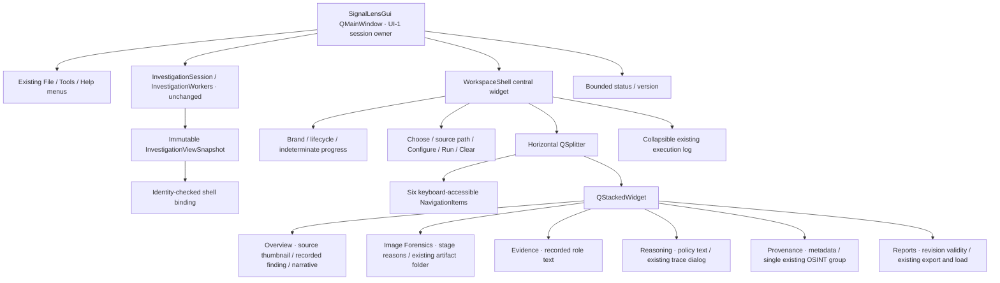

# UI-2 workspace architecture

`SignalLensGui` is now a QMainWindow. It remains the **single** UI-1 session/worker/report owner; no second controller, session object or forensic result store is created. Its current widget attributes still identify the same single controls used by the inherited lifecycle methods and tests. `WorkspaceShell` is its central widget and presentation/action-routing layer.

## Navigation and session binding

The destinations are Overview, Image Forensics, Evidence, Reasoning, Provenance and Reports. Buttons are mutually exclusive, support Tab/focus/activation and have Ctrl+1…6 actions. Switching the stack does not run analysis, commit annotations or regenerate reports. The selected destination and panel widths are GUI preferences, independent of the investigation.

`snapshot_changed` calls `WorkspaceShell.bind_snapshot`. Binding checks active session ID, result ID, annotation revision and lifecycle state before displaying anything. Delayed/obsolete snapshots are rejected, preserving UI-1's reentrant-selection and asynchronous-worker guards. Views receive read-only recorded values; evidence roles, confidence tiers, hypothesis selection and verification are not reinterpreted. Result clearing/new selection resets each view, including the source thumbnail. SourcePreview caches only a bounded display pixmap keyed by session/invocation identity, not a forensic payload.

Progress/status still travels through the guarded UI-1 slots. The shell's footer uses the same status_label and log_box; lifecycle and busy indicator consume the authoritative snapshot state. A completed result can be inconclusive, and missing stages remain explicitly unavailable/skipped with reasons. Report synchronization reflects session.report_current, not a new independent cache.

## Transitional content

Overview is a foundation, not the full UI-3 dashboard: a fit-only source thumbnail, primary recorded hypothesis/tier/explanation, compact hypothesis text, limitations region and retained report QTextEdit. Its vertical splitter gives the scrollable upper context and long narrative independent useful space. At minimum size, upper content can require scrolling; it remains reachable. There is no zoom synchronization, overlay, region selection or inference from pixels.

Image Forensics lists recorded stage statuses/reasons and opens the existing actual artifact directory. Imported summaries can reveal their source report directory; missing artifacts remain unavailable. Evidence is a read-only role/ID/explanation projection, not a sortable/filterable Evidence Explorer. Reasoning shows recorded policy narratives and retains the existing Decision Trace modal. Provenance reuses one OSINT group and its original dialogs beneath metadata declarations/verification. Reports calls the original revision-checked export/load paths; report content/storage contracts are unchanged.

All analysis configuration controls exist once in an owned modal Configure dialog. Profile/context remain captured by UI-1 on launch, not on navigation. Settings, Help, archive commands, stored-summary loading and current report export remain available. Settings and OSINT save/cancel workflows are retained.

## Resizing and persistence

Minimum 1040×720, normal default 1280×900; no fixed main-window size. A horizontal splitter resizes navigation/content; an Overview vertical splitter resizes context/narrative. Other workspaces use one primary scroll/text surface. Settings profile tabs and Provenance use scroll containers to avoid horizontal overflow.

`gui_workspace_state.py` stores only versioned `workspace/v1/` keys in the portable, Git-ignored signallens_workspace.ini: geometry, maximized state, two splitter size lists and destination. It stores no source path, image, session ID, result, annotation or confidence. QSettings is injectable for isolated tests. Malformed geometry/destination/size values fall back safely; restored geometry is checked against available screens so the title area remains reachable. Native geometry/maximized behavior uses Qt's [QMainWindow](https://doc.qt.io/qt-6/qmainwindow.html), [QWidget geometry support](https://doc.qt.io/qt-6/qwidget.html#restoreGeometry) and [QSettings](https://doc.qt.io/qt-6/qsettings.html).

Preferences save only when the inherited deferred-close path accepts closure after workers have retired. A backend that never returns can still delay closing; UI-2 introduces no unsafe termination or physical cancellation. App-directory preference writes can fail on a read-only installed directory; defaults still work. Moving portable preferences to a user-config directory is a packaging decision for a later release.
