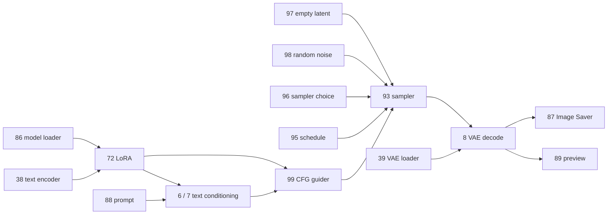

# Embedded workflow graph analysis

Evidence identity and RUN/TRACE paths: [root-cause report](root_cause_report.md#evidence-identity-and-method). Analysis is of unauthenticated declarations, not authenticated pixel provenance.

## Independent reconstruction

Parsed the actual PNG's `prompt` and `workflow` JSON with Pillow and the standard JSON parser. Both equal the extractor's saved values. The API Prompt has 22 node IDs. The UI Workflow has the same 22 nodes and 33 link records. For every node input expressed as `[source_node, output_slot]` in Prompt, checked the matching named UI input and its link's source ID, source slot and destination ID. No disagreements were found. All UI nodes have `mode=0`; no nested graph definitions/subgraphs were present.

Reverse traversal of the Image Saver's input dependencies reaches 21 nodes. The only nonancestor is PreviewImage 89, which is an active sibling output, not a disconnected unused generator. No disconnected graph component was found. The unused `denoised_output` is a port on an active node, not an inactive node.

## Node/edge evidence

API references below are under `Prompt["node_id"].inputs`. UI links use `[link_id, source_id, source_slot, target_id, target_slot, type]`.

| Function | Declared connection | UI link evidence |
|---|---|---|
| Base diffusion model | 86 UNet loader -> 72 LoraLoader `model` | 181: 86:0 -> 72:0 |
| Text encoder | 38 CLIPLoader -> 72 `clip` | 182: 38:0 -> 72:1 |
| Adapted model | 72 -> 99 CFGGuider `model` | 203: 72:0 -> 99:0 |
| Adapted text encoder | 72 -> 6 positive / 7 negative CLIPTextEncode | 172: 72:1 -> 6:0; 173: 72:1 -> 7:0 |
| Positive text | 88 String Literal -> 6 `text` | 159: 88:0 -> 6:1 |
| Conditioning | 6/7 -> 99 positive/negative | 199: 6:0 -> 99:1; 200: 7:0 -> 99:2 |
| Guidance value | 82 Cfg Literal -> 99 `cfg` | 197: 82:0 -> 99:3 |
| Guider | 99 -> 93 SamplerCustomAdvanced | 196: 99:0 -> 93:1 |
| Empty latent | 97 EmptyFlux2LatentImage -> 93 `latent_image` | 193: 97:0 -> 93:4 |
| Noise | 79 Seed Generator -> 98 RandomNoise -> 93 `noise` | 195: 79:0 -> 98:0; 194: 98:0 -> 93:0 |
| Sampler | 84 Sampler Selector -> 96 KSamplerSelect -> 93 `sampler` | 204: 84:0 -> 96:0; 189: 96:0 -> 93:2 |
| Schedule | 83 Int Literal -> 95 Flux2Scheduler -> 93 `sigmas` | 205: 83:0 -> 95:0; 192: 95:0 -> 93:3 |
| Sampling result | 93 output 0 -> 8 VAEDecode `samples` | 202: 93:0 -> 8:0 |
| VAE model | 39 VAELoader -> 8 `vae` | 76: 39:0 -> 8:1 |
| Saved pixels | 8 -> 87 Image Saver `images` | 167: 8:0 -> 87:0 |
| Preview pixels | 8 -> 89 PreviewImage | 168: 8:0 -> 89:0 |
| Dimensions | 80 width, 81 height -> scheduler and empty latent | 187/188 -> 95; 191/190 -> 97 |
| Saver descriptive inputs | 79 seed; 83 steps; 82 cfg; 86 modelname; 84 sampler_name; 88 positive; 80/81 dimensions -> 87 | 151, 152, 155, 156, 157, 160, 164, 161 |

The table covers all 33 UI edges. Image Saver metadata inputs do not constitute a second image transformation. The API carries the prompt string in node 88's `string` field and uses it through node 6 and the saver. Negative conditioning node 7 has empty text.



## Declared process and parameters

**Classification: coherent declared full-image generation from an empty latent, authenticity unverified.** This follows the image/latent path, not just checkpoint or LoRA names.

The model loader declares `flux-2-klein-base-9b.safetensors`; LoRA 72 declares the supplied FLUX.2 SmartphoneSnapshotPhotoReality style LoRA. Encoder 38 declares `qwen_3_8b.safetensors`, VAE 39 declares `flux2-vae.safetensors`. These identify declared model inputs but do not prove that binaries existed, matched these names or ran.

Node 97 receives 1024 x 1024 dimensions with batch size 1. Node 98 receives seed 1234567890. Scheduler 95 receives 50 steps from node 83; guider 99 receives cfg 4.0 from node 82. Sampler selection resolves to Euler. These **linked values** take precedence over UI widget fallback values (e.g. scheduler widget 20 and guider widget 5). Image Saver node 87's `denoise=1.0` is a saver input; it is not a graph link demonstrating enhancement or independently proving sampler denoising strength.

| Process | Declared by this active image path? | Reason |
|---|---|---|
| Empty-latent full generation | Yes, with limitations | 97 -> 93 -> 8 -> 87 and model/text/noise inputs. |
| Image-to-image | No | No external image input or image-to-latent encoding enters the path. |
| Inpainting | No | No source-image/mask conditioning or inpaint encoding path is present. |
| Enhancement/upscaling | No separate operation established | No active upscaler/restorer/image enhancement stage is represented. A sampler output name and saver denoise parameter are insufficient. |
| Multiple creation stages | Not shown | One sampler/decode stage; LoRA model adaptation and saving are not second image-generation passes. |
| External editing/postprocessing | Unknown | Metadata cannot exclude actions before/after this recorded graph. |

## Ambiguities and supported interpretation boundary

This is a structural audit of declared interfaces. Image Saver, UNet loader, literals and sampler selector include custom nodes. Their implementations were not available as part of this repository audit. The graph alone cannot establish arbitrary custom-node runtime behavior. A Task B parser must use explicit recognized interface contracts, record assumptions and abstain when unknown nodes can change image/latent flow.

Do not treat every `mode=0` node as executed proof. Here it indicates normal declared UI mode and agrees with the API representation; it does not authenticate execution. Future bypassed/muted nodes, reroutes, nested graphs, missing links, duplicate IDs, cycles, multiple savers or disagreeing Prompt/Workflow records require explicit partial/unsupported/conflicting status. An unrelated sampler must never qualify an unconnected saver as generation.

No `LoadImage`, VAEEncode, mask or image editing input was found on the saver path. Absence is meaningful **within the declared graph and recognized interfaces**; it is not proof that no real photograph was involved elsewhere. The current file hash and matching metadata copies do not prevent transplantation or fabrication.

## Minimal proposed data contract

Add a versioned, optional interpretation under metadata details and the persisted reasoning trace:

```json
{
  "schema_version": 1,
  "declared_process": "full_image_generation",
  "graph_interpretation_status": "coherent_with_declared_interface_assumptions",
  "provenance_authenticity": "unverified",
  "supporting_node_paths": [
    {"source_field": "PNG:Prompt", "sink_node": "87", "nodes": ["97", "93", "8", "87"], "output_slots": [0, 0, 0]}
  ],
  "interpretation_limitations": [
    "Embedded graph is a declaration, not authenticated execution history.",
    "Custom-node runtime semantics are not authenticated."
  ]
}
```

Suggested process vocabulary: `full_image_generation`, `image_to_image`, `inpainting`, `enhancement`, `mixed`, `indeterminate`; status vocabulary should distinguish `coherent`, `partial`, `unsupported`, `conflicting`, `invalid`, and recognized-interface assumptions. Preserve path references for all relevant output sinks; do not overload trust with parse success. Add source-field/node/link references and declaration identity to avoid describing Prompt and Workflow as two independent sources.

`ModuleSummary.details` (`gui_semantics.py:111`) and `SummaryResult.reasoning_trace` (`summary_types.py:16`) can carry additive fields. `ProvenanceState` can remain unchanged. A small immutable internal type/parser is appropriate, but new top-level detector stages, graph execution, authentication services or new scored domains are unnecessary. Explicit adapters/rendering are still needed: the GUI currently projects selected fields and will not automatically display an arbitrary new details dictionary.
