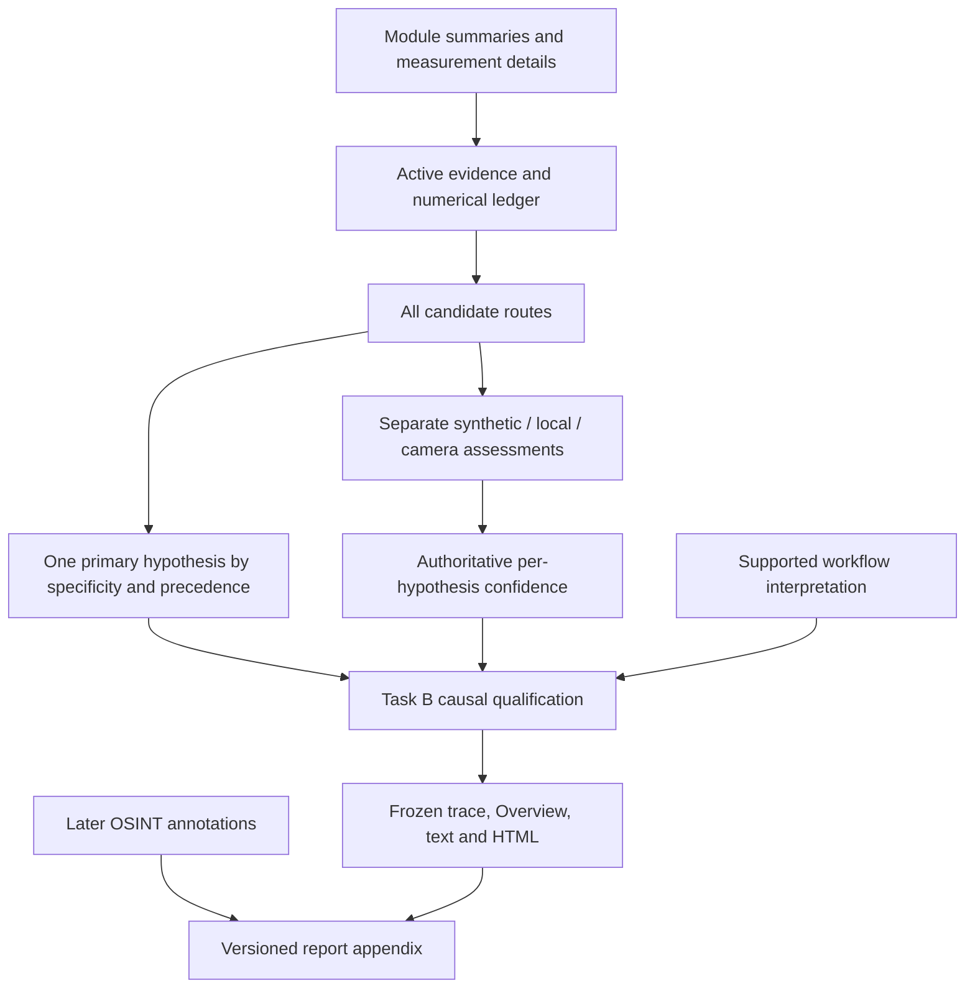

# Origin, regional observations and edit history: architecture review

Task C design only. Evidence: [root causes](root_cause_report.md), [boundary and scoring audit](boundary_reliability_audit.md). No source changes or new confidence rules were implemented.

## Existing architecture and semantic collision



Source anchors: `decision_logic.py:1336-1512`, `evaluate_hypotheses`; `:1311`, `_apply_confidence_policy`; `:1515`, `_qualify_causal_interpretation`; `investigation_session.py:110,140`; `investigation_reports.py:51-86`.

The model already permits simultaneous hypotheses. The issue is not mutually exclusive evidence storage, but **one dominant finding across incomparable questions**. `synthetic_origin` is a claim about creation; `camera_acquisition` is compatibility with a pipeline; `localized_editing` combines regional anomaly strength with named mechanisms and an inferred operation. `Finding.BOUNDARY_DECISIVE` remains in the decisive-local-mechanism specificity class (`confidence_policy.py:49-61`) even when the explanation expressly denies establishing an operation.

Selection uses that class before confidence evaluation. Task B deliberately preserved the primary and tiers, then added a record saying the local tier concerns anomalies. A later textual qualification cannot revise the already chosen finding's machine meaning. This is an intentional compatibility decision with incomplete general semantics, not just an accidentally stale GUI label.

The non-graph gap is sharper: technical provenance is explicitly unverified in `/provenance_evidence`, but the added causal record labels it `not_assessed` solely because there is no `workflow_interpretation`. `declared_process=null` is appropriate for unknown detailed process topology; it must not erase the known generation declaration. Declaration category, detailed process, model attribution and authenticity need separate fields.

## Options A-D

| Option | Defensibility and false-positive/metadata-trust risk | Compatibility, presentation and traceability | Complexity, regression risk and generalization |
|---|---|---|---|
| A: clarify presentation only | Useful immediately, but Task B already does much of it. Cannot repair the wrong strength witness or causal meaning of a decisive edit identifier. Unsigned claims stay bounded, but readers/consumers may still mistake local High for edit history. | Low migration cost; existing Overview qualifier is an example. Machine primary, card grouping and exported decision fields still disagree semantically. | Low code cost, incomplete correction; cannot generalize a graph-specific lead by relabeling alone. |
| B: generalize primary selection | Can require actual mechanism-specific support before an edit-history candidate competes with origin. Must not always favor declarations, compare unlike tiers as probabilities, or hide contradictory observations. | Needs explicit finding classes and versioned selection reasons. A precedence-only patch without dimensional semantics risks breaking historical consumers and existing local/clone safeguards. | Moderate; useful as headline arbitration after categories are separated. A Midjourney exception would have poor generalization. |
| C: bounded multidimensional conclusion | Best matches what the evidence can establish: an origin declaration, regional measurements and insufficient evidence of an additional edit can coexist. Keeps unsigned origin claims separate from authenticity and external corroboration. | Add one authoritative versioned conclusion object; retain frozen legacy fields and old-report fallback. Existing Overview/cards/report blocks can project it without new workspaces. Every dimension has its own subject, support scope, evidence and uncertainty. | Moderate but bounded; avoids reworking detectors/ledger. Generalizes to generator prose, graphs, IPTC, stripped images, real photos, mixed edits and absent evidence. |
| D: numerical recalibration | Does not repair ineligible strength input, lost outcome state or semantic scope. Arbitrary score increases could overtrust metadata; arbitrary local penalties could suppress legitimate mechanisms. | Broad effects on ledger, thresholds, references and reports; substantial calibration/migration burden. | High empirical/regression cost. Appropriate only as a separate measured study after state/contract correctness, not as this case's remedy. |

## Recommendation: narrow C with explicit causal eligibility from B

First repair the two demonstrable eligibility/outcome defects. Introduce one small **authoritative conclusion contract** with separate origin, processing-anomaly, separate-edit, technical-authenticity and external-source dimensions. Build it from existing assessed evidence; do not add a detector or new numeric domain. Then derive the lead/headline deterministically from those typed dimensions. This is smaller and safer than continually adding generator-specific exceptions to the old primary competition.

Retain the existing legacy hypothesis ledger and tiers for compatibility and forensic audit. Stop using a regional-only finding as a newly established edit-history conclusion. An operation-specific hypothesis may lead when explicit mechanism evidence is established under its own requirements; a declared process never vetoes that evidence. Neither absence of provenance nor an inconclusive check establishes another origin. When the edit is unestablished, a joint qualified lead or unresolved origin/processing relationship is valid; no forced `synthetic_origin: High` is required.

Suggested recorded lead for this evidence, subject to the corrected gate rather than an assumed future tier:

> Embedded metadata declares AI-mediated generation. Regional anomalies are present, but the available checks do not establish a separate editing operation. Provenance is unverified.

If source corroboration is later recorded as its own revision, add the exact correspondence and publisher's creation claim with its limits. Do not silently alter the original technical analysis. The current audit's external observation does not become analysis-time evidence retroactively.

## Minimal proposed contract

Illustrative shape, not implemented or a new calibrated policy:

```json
{
  "schema_version": 2,
  "origin_assessment": {
    "claim": "declared_ai_generation",
    "support_tier": "Medium",
    "evidence_ids": ["metadata:EMBEDDED_GENERATION_PROMPT", "metadata:DECLARED_SYNTHETIC"],
    "declared_process": "unspecified_generation_process",
    "workflow_interpretation": null,
    "generator_attribution": {"name": "Midjourney", "basis": "unverified_embedded_signature"}
  },
  "processing_anomaly_assessment": {
    "status": "observations_present",
    "support_tier": null,
    "support_scope": "regional_measurements",
    "applicability_limitations": ["person-boundary localization not established by hotspot alignment"]
  },
  "separate_edit_assessment": {
    "status": "not_established",
    "mechanism": null,
    "chronology": "unknown",
    "basis": "regional_anomalies_are_not_an_edit_history"
  },
  "technical_provenance_authenticity": {
    "status": "unverified",
    "validator_result": null
  },
  "external_source_corroboration": {
    "status": "not_recorded_at_analysis_time",
    "source_image_match_status": "not_assessed",
    "creator_generation_claim": null,
    "evidence_dependency": []
  },
  "lead": {
    "rule_id": "declared_origin_with_unresolved_processing_history",
    "text": "Recorded qualified joint interpretation",
    "confidence_scope": "per_dimension_only"
  },
  "legacy_primary_hypothesis": "localized_editing"
}
```

The anomaly tier above is deliberately unspecified until corrected eligibility is evaluated. No new probability or tier is inferred by this audit. Distinct creation process `unspecified_generation_process` preserves a substantive declaration without fabricating empty-latent, full-image, img2img or inpainting topology. `generator_attribution` is contextual, not authenticated identity.

Each dimension should carry supporting, moderating, contradicting and unavailable/outcome references where applicable. A completed inconclusive measurement needs an explicit state distinct from missing/skipped/failed and from active positive scoring. Observations may be reused by interpretations, but dependency IDs prevent describing derived restatements as new independent observations. A dimension-specific confidence policy must name its **claim**, so a boundary anomaly tier cannot be transferred to editing chronology.

### Strength, reliability and applicability contract

Represent the boundary compound's eligible indicators separately from its strength witnesses. A witness includes evidence ID, positive/neutral/contradicting outcome, field, scale and detector-specific predicate. The current inconclusive raw Focus intensity must not become an affirmative 0-to-1 strength surrogate. Preserve the required count and valid positive controls; no universal replacement threshold is justified by one image.

Carry mask quality (`medium/limited`), person geometry eligibility, band support, measured hotspot alignment, background sample/content reliability and causal applicability as distinct concepts. Do not replace these with one scalar called reliability or use 86% foreground coverage alone to cap confidence. Preserve the actual 0.6 background baseline limitation. Person geometry availability does not register intrinsic image edges to the person boundary.

### External evidence contract

Current annotations already store page/image URLs and notes, so this case does not require a network feature to avoid semantic misclassification. A later optional corroboration record should separate:

- `technical_provenance_authenticity`: signature/validator result and image binding, or unverified;
- `external_source_corroboration`: retrieved-and-inspected, analyst-documented or URL-only status;
- `source_image_match_status`: exact bytes, exact decoded pixels, qualified perceptual candidate, mismatch or unassessed;
- `creator_generation_claim`: claimed creator/publisher, exact claim location, source date and inspection time, without claiming independent authentication;
- `evidence_dependency`: linkage to the same embedded assertion, publisher asset or upstream claim, avoiding double votes.

Exact-byte matching of the analyzed file and a publisher-hosted file proves their file correspondence. It does not prove pixel origin, authorship or independent corroboration of creation history. A copied prompt on two pages is still potentially one upstream claim. Perceptual matching, if later built, needs its own method/threshold/crop/transform limitations and must never be mislabeled exact. Mere URL/title keyword classification is neither retrieval nor a match.

## Implementation and compatibility impact

Likely modules: `decision_logic.py`, `confidence_policy.py`/`confidence_policy_inputs.py` for claim-specific interpretation facts, `hypothesis_engine.py` for complete outcome versus positive-credit separation, `metadata_evidence.py` and `summary_sections.py` for generalized declaration/process adapters. Parser-specific details in `workflow_interpretation.py` remain optional; non-graph cases should not be forced through a graph parser.

`ModuleSummary.details` and `SummaryResult.reasoning_trace` can carry a versioned object, but do not rely on an untyped dictionary alone for enforcement. A small immutable internal record and explicit adapter should establish the authoritative contract. Add optional immutable presentation fields in `presentation_models.py`, project in `investigation_presenters.py`, and render in existing Overview/Reasoning/Provenance/report surfaces. No new workspace or general execution framework is necessary.

Historical results keep their exact stored conclusions; absence of version 2 means historical scope not recorded, not a fresh negative result. New presentation may identify legacy ambiguity without recomputing the result. New analyses record the corrected conclusion and legacy fields with documented compatibility semantics. External corroboration acquired later belongs to a versioned report synthesis linked to immutable analysis identity; it must not mutate the prior forensic trace. Preserve explicit analyst annotation revisions and original source hashes.

No automatic migration, baseline rewrite, network API, detector recalibration or maximum-tier ranking is part of the minimal correction. The next implementation must report any changed routes caused by valid strength/outcome handling rather than manipulating expectations to preserve the current High or to force generation High.
